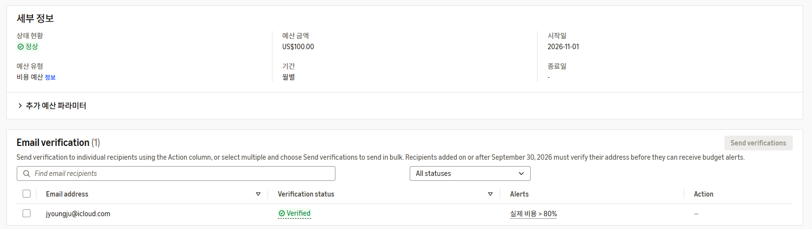
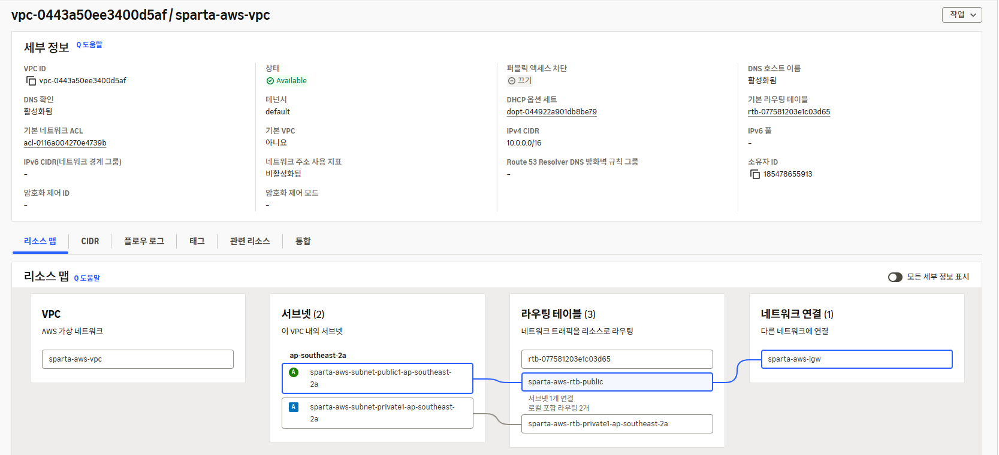
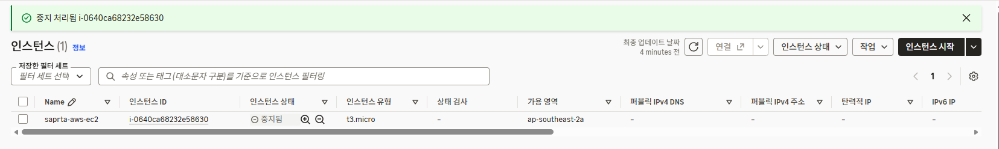
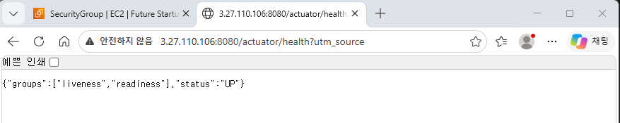

# AWS Budgets



## Lv.1 VPC 설계 및 EC2 생성

### 1. VPC 설계
- 리전: ap-southeast-2 (시드니)
- VPC 이름: sparta-aws-vpc
- IPv4 CIDR: 10.0.0.0/16
- Public / Private Subnet 분리
- Public Subnet에 인터넷 게이트웨이 연결
- Private Subnet은 별도의 라우팅 테이블 사용



### 2. EC2 인스턴스 생성
- 인스턴스 이름: sparta-aws-ec2
- 운영체제: Amazon Linux 2023
- 인스턴스 유형: t3.micro
- 서브넷: Public Subnet
- SSH 접속: PowerShell에서 PEM 키를 이용해 접속 성공
- 작업 종료 후 인스턴스 중지



### 3. Spring Boot API 구현

팀원 정보를 저장하고 조회하는 REST API를 구현했습니다.

| HTTP Method | Endpoint | 기능 |
|---|---|---|
| POST | `/api/members` | 팀원 이름, 나이, MBTI 저장 |
| GET | `/api/members/{id}` | ID를 이용한 팀원 정보 조회 |

- Spring Data JPA를 이용한 데이터 저장 및 조회
- `ResponseStatusException`을 이용한 404 예외 처리
- Postman을 통한 API 정상 동작 확인

### 4. Profile 분리

실행 환경에 따라 데이터베이스 설정을 분리했습니다.

| 설정 파일 | 역할 |
|---|---|
| `application.yml` | 공통 설정 |
| `application-local.yml` | 로컬 H2 데이터베이스 |
| `application-prod.yml` | 운영 MySQL 데이터베이스 연결 설정 |

- 로컬 환경에서는 H2 데이터베이스 사용
- 운영 환경에서는 MySQL을 사용하도록 설정
- DB 접속 정보는 환경변수를 통해 관리
- 실제 RDS 연결은 Lv.2에서 진행 예정

### 5. API 로그 및 공통 예외 처리

#### INFO 로그

`OncePerRequestFilter`를 상속한 `ApiLoggingFilter`를 구현하여 HTTP 요청이 들어올 때마다 INFO 로그를 기록하도록 설정했습니다.

```text
[API - LOG] POST http://localhost:8080/api/members
[API - LOG] GET http://localhost:8080/api/members/1
```

#### ERROR 로그

`@RestControllerAdvice`와 `@ExceptionHandler`를 이용하여 공통 예외 처리를 구현했습니다.

- `ResponseStatusException` 발생 시 예외 처리
- ERROR 레벨 로그 및 스택트레이스 기록
- HTTP 상태 코드와 예외 메시지를 클라이언트에 반환
- 존재하지 않는 회원 ID 조회 시 404 응답 확인

### 6. Actuator Health Check

Spring Boot Actuator 의존성을 추가하고 Health Check 엔드포인트를 노출했습니다.

**로컬 테스트 URL**

`http://localhost:8080/actuator/health`

**응답 결과**

```json
{
  "groups": [
    "liveness",
    "readiness"
  ],
  "status": "UP"
}
```

### 7. EC2 애플리케이션 배포 및 외부 접속 검증

#### 배포 과정

1. Amazon Linux 2023에 Java 17 설치
2. Gradle `bootJar`를 이용해 실행 가능한 JAR 파일 생성
3. SCP를 이용해 EC2 서버로 JAR 파일 전송
4. EC2에서 Spring Boot 애플리케이션 실행
5. EC2 보안 그룹에 TCP 8080 포트 인바운드 규칙 추가
6. 외부 브라우저에서 Actuator Health Check 정상 응답 확인

#### EC2 배포 정보

| 항목 | 내용 |
|---|---|
| 리전 | ap-southeast-2 (시드니) |
| 인스턴스 | sparta-aws-ec2 |
| 퍼블릭 IPv4 | `3.27.110.106` |
| 애플리케이션 포트 | 8080 |
| 실행 프로필 | local (H2) |
| Health Check 결과 | UP |

#### 외부 접속 검증

**Actuator Health Check URL**

http://3.27.110.106:8080/actuator/health

- EC2에 Spring Boot 애플리케이션 배포 완료
- 외부 브라우저에서 Actuator Health Check 정상 응답 확인
- 응답 결과: `status: UP`

