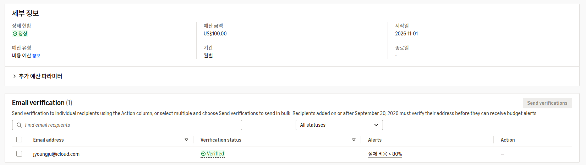
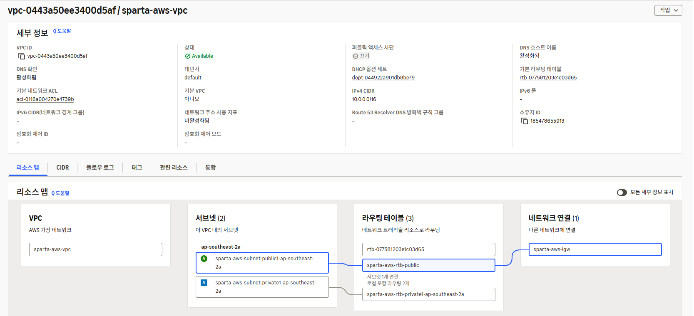
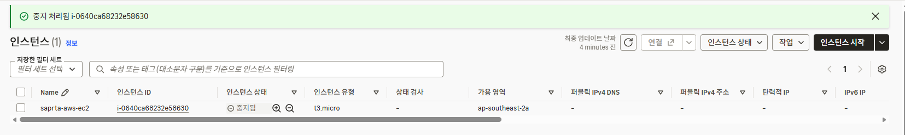

# AWS Budgets

## Lv.1 VPC 설계 및 EC2 생성

### 1. VPC 설계
- 리전: ap-southeast-2 (시드니)
- VPC 이름: sparta-aws-vpc
- IPv4 CIDR: 10.0.0.0/16
- Public / Private Subnet 분리
- Public Subnet에 인터넷 게이트웨이 연결
- Private Subnet은 별도의 라우팅 테이블 사용

### 2. EC2 인스턴스 생성
- 인스턴스 이름: sparta-aws-ec2
- 운영체제: Amazon Linux 2023
- 인스턴스 유형: t3.micro
- 서브넷: Public Subnet
- SSH 접속: PowerShell에서 PEM 키를 이용해 접속 성공
- 작업 종료 후 인스턴스 중지

